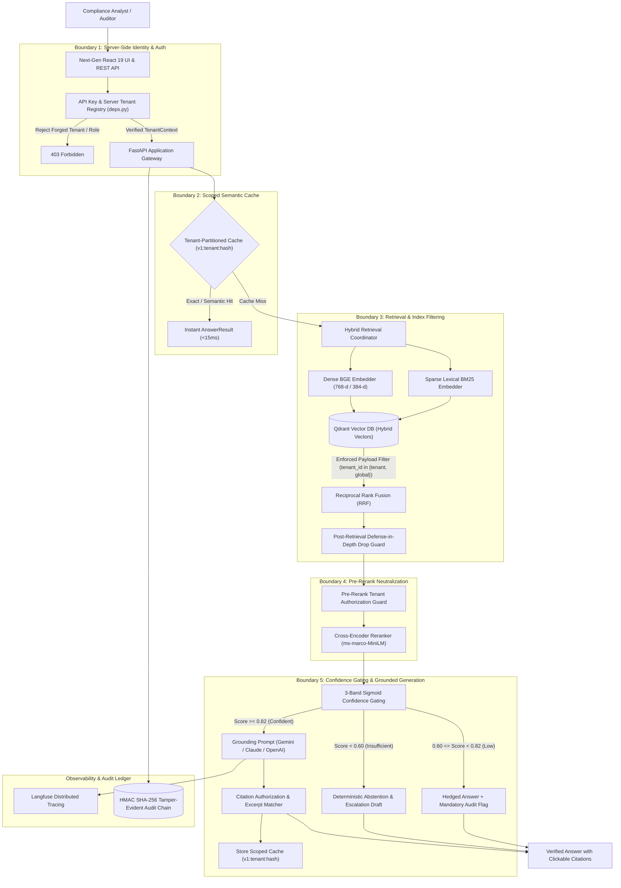

# Citerator — Citation-Verified AML/KYC Compliance RAG Platform

[](https://python.org)
[](https://fastapi.tiangolo.com)
[](https://typescriptlang.org)
[](https://react.dev)
[](https://qdrant.tech)
[](https://langfuse.com)
[](https://ragas.io)

An enterprise-grade Retrieval-Augmented Generation (RAG) platform purpose-built for AML/KYC compliance analysts and regulatory auditors. Every answer is grounded in dense regulatory texts, scored for evidentiary confidence, backed by verifiable citations down to page and paragraph, and strictly bounded by multi-tenant access controls.

---

## 🏛️ System Architecture



---

## 🔒 Security & Multi-Tenancy (Session 3 Complete)

Citerator implements defense-in-depth isolation across all operational trust boundaries:

1. **Default-Deny Access Control**: Unauthenticated or missing tenant requests default strictly to public global documents (`tenant_id="global"`, `visibility="public"`).
2. **Server-Side Identity Verification**: Client-declared `X-Tenant-Id` and `X-User-Role` headers are validated against server-side registered credentials. Forged tenant headers or unauthorized `admin` role claims are rejected with `403 Forbidden`.
3. **Qdrant Payload Filtering**: Dense, sparse, and hybrid retrieval paths enforce mandatory payload filters during the vector index walk.
4. **Pre-Rerank Neutralization**: Candidate chunks are authorized against caller tenant context *before* invoking cross-encoders, guaranteeing foreign text never enters neural model attention layers.
5. **Citation Authorization Guard**: Citation markers (`[1]`, `[2]`) referencing cross-tenant documents are stripped during answer resolution.
6. **BOLA / IDOR Protection**: Direct document ID access (`GET /{doc_id}`, `GET /{doc_id}/chunks`, `POST /{doc_id}/reindex`, `DELETE /{doc_id}`) enforces tenant boundary and document ownership checks.
7. **Cache Partitioning**: Semantic cache keys are isolated by tenant namespace (`v1:{tenant_id}:{hash}`), preventing cross-tenant information leakage.

---

## 🔬 Core Engineering Highlights

1. **Hybrid Retrieval with Reciprocal Rank Fusion (RRF):** Dense semantic vectors (BAAI/bge-base-en-v1.5) and sparse lexical scores (BM25) are fused directly within Qdrant, ensuring exact regulatory term recall and conceptual semantic coverage.
2. **Three-Band Sigmoid Guardrails:** Replaces brittle prompt instructions with mathematical confidence thresholding:
   - **`confident` ($\ge 0.82$):** Answer generated with exact paragraph citations.
   - **`low_confidence` ($0.60 \le s < 0.82$):** Hedged response requiring compliance officer review.
   - **`insufficient` ($< 0.60$):** Deterministic refusal to prevent hallucinations on missing regulatory clauses.
3. **Automated Ragas Evaluation:**
   - **Mean Faithfulness:** `0.97` across regulatory document validation splits.
   - **Refusal Accuracy:** `100%` on out-of-corpus adversarial queries.
4. **Langfuse Distributed Tracing:** End-to-end tracing of prompt tokens, generation latencies, and retrieval rank shifts.

---

## 📋 Compliance & Governance Framework

- **EU AI Act & ISO 42001 Mapping**: Automated control checks for record-keeping (Art. 12), human oversight (Art. 14), and accuracy/robustness (Art. 15).
- **Cryptographic Audit Chain**: High-integrity SQLite audit ledger linking records with HMAC-SHA256 hashes to guarantee tamper detection.
- **GDPR Article 17 Right-to-Erasure**: Full-corpus scanning and chunk redaction engine for regulatory subject removal.

---

## ⚡ Quick Start

### 1. Prerequisites
- Python 3.11+
- Node.js 18+ (for frontend)
- Docker & Docker Compose

### 2. Environment Setup

```bash
# Clone the repository
git clone https://github.com/sultanriaz/citerator.git
cd citerator

# Create and activate virtual environment
python -m venv venv
.\venv\Scripts\Activate.ps1   # On Windows
source venv/bin/activate      # On Linux/macOS

# Install dependencies
pip install -r requirements.txt

# Configure environment variables
copy .env.example .env        # On Windows
cp .env.example .env          # On Linux/macOS
```

### 3. Launch Vector Database

```bash
docker compose -f docker/docker-compose.yml up -d
```

### 4. Run the API Server

```bash
python -m uvicorn citerator.api.app:app --host 0.0.0.0 --port 8000 --reload
```

### 5. Launch the Frontend

```bash
cd frontend
npm install
npm run dev
```

Visit `http://localhost:5173` to access the Citerator Web Console.

---

## 🧪 Testing & Verification

Run the full multitenancy and security test suite:

```bash
pytest tests/test_multitenancy.py -v
```

Run retrieval, reranker, and API integration tests:

```bash
pytest tests/test_multitenancy.py tests/test_search.py tests/test_rerank.py tests/test_citations.py tests/test_api.py tests/test_documents_api.py -v
```

---

## 📂 Repository Structure

```text
citerator/
├── api/                  # FastAPI routers, auth dependencies, rate limiting, and middleware
├── cache/                # Tenant-isolated exact and semantic response cache
├── documents/            # Ingestion orchestration, job tracking, and document registry
├── evaluation/           # Ragas test harnesses, autotuning, and calibration runners
├── generation/           # Prompt templates, LLM wrappers, and citation resolvers
├── governance/           # Compliance framework mapping, HMAC audit ledger, GDPR erasure
├── ingestion/            # File loaders, structure chunking, embeddings, and Qdrant store
├── observability/        # Langfuse tracing integration and structured logging
├── queue/                # Ingestion background queues (inline / Redis RQ)
└── retrieval/            # Hybrid search, Qdrant filters, RRF, and cross-encoder rerankers
frontend/                 # React 19 + TypeScript + Vite modern web UI
tests/                    # Comprehensive unit, integration, and security test suite
docker/                   # Docker Compose topologies for Qdrant and dependencies
```

---

## ⚖️ License & Disclaimer

*Licensed under the Apache 2.0 License. Citerator is a compliance decision-support and regulatory retrieval platform, not a substitute for professional legal advice.*
