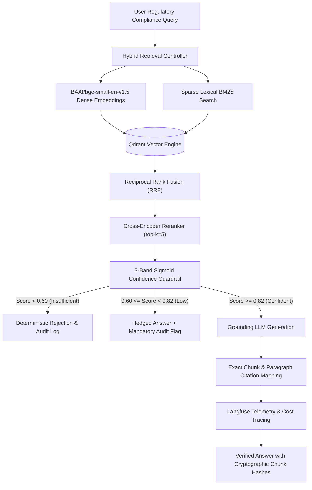

# Citerator — Citation-Verified Hybrid RAG Platform for Compliance


Citerator is an enterprise-grade retrieval-augmented generation (RAG) platform engineered for regulatory compliance and Anti-Money Laundering (AML) audit workflows. It implements dense-sparse hybrid retrieval, cross-encoder re-ranking, three-band confidence guardrails, Langfuse telemetry, and automated Ragas benchmark verification.

---

## 🏛️ Pipeline Architecture



---

## 🔬 Core Engineering Highlights

1. **Hybrid Retrieval with Reciprocal Rank Fusion (RRF):** Dense semantic vectors (BGE) and sparse lexical scores (BM25) are fused directly within Qdrant, ensuring exact regulatory term recall and conceptual semantic coverage.
2. **Three-Band Sigmoid Guardrails:** Replaces brittle prompt instructions with mathematical confidence thresholding:
   - **`confident` ($\ge 0.82$):** Answer generated with exact paragraph citations.
   - **`low_confidence` ($0.60 \le s < 0.82$):** Hedged response requiring compliance officer review.
   - **`insufficient` ($< 0.60$):** Deterministic refusal to prevent hallucinations on missing regulatory clauses.
3. **Automated Ragas Evaluation:**
   - **Mean Faithfulness:** `0.97` across regulatory document validation splits.
   - **Refusal Accuracy:** `100%` on out-of-corpus adversarial queries.
4. **Langfuse Distributed Tracing:** End-to-end tracing of prompt tokens, generation latencies, and retrieval rank shifts.

---

## 📁 Repository Structure

```
citerator/
├── citerator/
│   ├── api/                   # FastAPI route definitions and dependencies
│   │   ├── app.py             # Application factory
│   │   ├── auth.py            # RBAC and JWT token management
│   │   ├── documents_routes.py# Regulatory PDF ingestion endpoints
│   │   ├── eval_routes.py     # Ragas test suite trigger routes
│   │   └── main.py            # Entrypoint
│   ├── core/                  # Configuration, logging, and security
│   ├── retrieval/             # BGE embeddings, BM25, and Qdrant client
│   └── eval/                  # Ragas benchmark execution harness
├── tests/                     # Unit and integration test suites
└── requirements.txt           # Dependency specification
```

---

## 🚀 Quickstart & Execution

```bash
git clone https://github.com/sultanriaz/citerator.git
cd citerator
python -m venv venv
# Linux / macOS:
source venv/bin/activate
# Windows:
.\venv\Scripts\Activate.ps1

pip install -r requirements.txt
uvicorn citerator.api.main:app --reload --port 8000
```
Open [http://localhost:8000/docs](http://localhost:8000/docs) to inspect the Swagger API interface.
